# Hazard-Image-Analysis-Agent

> Knowledge-enhanced multimodal agent for fire-safety hazard image analysis.

[](#quick-start)
[](backend/README.md)
[](docs/ALGORITHMS.md)
[](docs/ALGORITHMS.md#8-open-set-guardrail)
[](LICENSE)

## At a Glance
 
| Dimension | Design |
| --- | --- |
| Task | Fire-safety hazard image analysis |
| Core method | Two-hop inference + evidence-tree RAG + open-set guardrail |
| Knowledge base | Structured fire-safety rules, scene guides and production-safety playbooks |
| Backend | FastAPI, SQLAlchemy, SQLite, modular services |
| Frontend | Static Web demo and WeChat Mini Program |
| Evaluation | Retrieval ablation, strong baselines, open-set guardrail benchmark |
| Output | Risk level, hazard explanation, cited evidence, corrective actions and history |


## Core Capabilities

| Capability | Description |
| --- | --- |
| Multimodal inspection | Upload a fire-safety scene image and extract visual facts. |
| Evidence-grounded reasoning | Retrieve fire-safety rules before producing risk conclusions. |
| Scene-aware retrieval | Route queries by campus, residential, industrial and construction contexts. |
| Conservative refusal | Refuse or ask for human review when evidence is weak. |
| Memory and governance | Track historical cases, recurring hazards, open tasks and risk trends. |
| Debuggable pipeline | Return retrieval queries, evidence IDs, guardrail decisions and latency fields. |

## Method Highlights

### 1. Two-Hop Evidence-Constrained Inference

```text
Stage 1: Visual Fact Extraction
Y1 = g_vlm(I, s, u) = {o, h, k, r_h}

Stage 2: Evidence-Constrained Reasoning
Y2 = g_llm(Y1, E) = {r, Z, A}
```

### 2. Scene-Aware Hybrid RAG

```text
S_base(d,q) = alpha * S_lex + beta * S_vec + gamma * S_dense
S(d,q) = S_base + b_scene + b_path + b_hint
```

### 3. Evidence Tree Retrieval

```text
Score_tree(d) = sum_{p in P(d)} w_p * s_p(d)
```
### 4. Submodular Evidence Set Selection


```text
Delta(d | E)
  = w_R  * R(d)
  + w_N  * novelty(d, E)
  + w_sD * source_diversity(d, E)
  + w_hD * hazard_coverage(d, E)
```

### 5. Dynamic Retrieval Budget


```text
C(q) = lambda_1 * len(q)
     + lambda_2 * |h|
     + lambda_3 * I(scene = industrial)
     + lambda_4 * conflict(h)

K(q) = K_min + eta * sigmoid(C(q))
```

### 6. Open-Set Guardrail


```text
Guard(q) = I(n_cand < tau_n or s_top < tau_s or cover < tau_c)
```


### 7. Four-Layer Memory

- **Core Memory**
- **Task Memory**
- **Short-Term Memory**
- **Long-Term Memory**

[docs/ALGORITHMS.md](docs/ALGORITHMS.md)。

## System Architecture

```mermaid
flowchart LR
    U["Web / WeChat Mini Program"] --> API["FastAPI Service"]
    API --> A["FireAgent Orchestrator"]
    A --> V["Stage1 VLM<br/>visual facts"]
    V --> Q["Query Builder<br/>main / scene / hazard"]
    Q --> R["Hybrid Retriever<br/>lexical + vector + dense"]
    R --> T["Evidence Tree<br/>path aggregation"]
    T --> S["Set Selection<br/>diversity + coverage"]
    S --> G["Open-Set Guardrail"]
    G --> L["Stage2 LLM<br/>evidence-constrained reasoning"]
    L --> DB["SQLite<br/>records / memory / cache"]
    DB --> U
```



## Repository Layout

```text
.
├── backend/                    # FastAPI backend and experiments
│   ├── app/
│   │   ├── api/                # REST APIs
│   │   ├── core/               # config, CORS, settings
│   │   ├── data/               # fire rules and scene playbooks
│   │   ├── db/                 # SQLAlchemy models and CRUD
│   │   └── services/           # analyzer, retriever, guardrail, memory
│   ├── eval_*.py               # retrieval / guardrail / baseline evaluation
│   └── requirements.txt
├── web/                        # static Web demo
├── pages/ utils/ app.*          # WeChat mini program entry
├── docs/                       # algorithm notes and technical documentation
```

## Experimental Snapshot

The project includes reproducible retrieval and guardrail evaluation scripts under `backend/`.

| Setting | Dataset | Top-1 | Top-3 | MRR |
| --- | --- | ---: | ---: | ---: |
| Dynamic retrieval | dev-650 | 0.5092 | 0.9123 | 0.7019 |
| Set selection | dev-650 | 0.5092 | 0.9000 | 0.7047 |
| Evidence tree | dev-650 | **0.5938** | 0.9015 | **0.7447** |
| Dynamic retrieval | blind-650 | 0.4554 | 0.8769 | 0.6555 |
| Set selection | blind-650 | 0.4554 | 0.8662 | 0.6560 |
| Evidence tree | blind-650 | **0.5338** | 0.8585 | **0.6899** |

Open-set guardrail evaluation:

| Guardrail | Samples | Refusal Precision | Refusal Recall | False Accept |
| --- | ---: | ---: | ---: | ---: |
| hybrid_local | 200 | 1.000 | 0.290 | 142 |
| strict_guardrail | 200 | **1.000** | **0.365** | **127** |

Interpretation:

- Evidence tree improves Top-1 by about **8.46 points** on the dev set and **7.84 points** on the blind set compared with dynamic retrieval.
- Guardrail precision is high, but refusal recall remains an important future-work direction.
- The benchmark focuses on rule retrieval and evidence grounding; the system is a research prototype rather than a certified fire-safety product.

## Quick Start

### Backend

```powershell
cd backend
pip install -r requirements.txt

# Optional: configure real multimodal / text model calls.
$env:SILICONFLOW_API_KEY="your_api_key"

uvicorn app.main:app --host 0.0.0.0 --port 8010 --reload
```

Useful endpoints:

- API docs: `http://127.0.0.1:8010/docs`
- Health check: `http://127.0.0.1:8010/health`
- Web demo mounted by backend: `http://127.0.0.1:8010/web/`

### Web Frontend

The static frontend lives in `web/` and uses `http://127.0.0.1:8010` as the default backend.

```powershell
# Option 1: served by FastAPI after backend startup
http://127.0.0.1:8010/web/

# Option 2: standalone static server
python -m http.server 5500
http://127.0.0.1:5500/web/index.html
```

### WeChat Mini Program

Open the repository root in WeChat DevTools. The mini program entry files are:

- `app.js`
- `app.json`
- `pages/`
- `utils/`

Set `utils/config.js` to the reachable backend address, for example `http://127.0.0.1:8010` or a LAN IP address during device debugging.

## Core APIs

All versioned APIs are under `/api/v1`.

| Method | Endpoint | Description |
| --- | --- | --- |
| `POST` | `/analysis/upload` | Upload an image and run two-hop analysis |
| `GET` | `/records` | Query historical analysis records |
| `GET` | `/records/{record_id}` | Get one analysis detail |
| `GET` | `/records/insights` | Aggregate recent risk trends |
| `POST` | `/agent/chat` | Chat with the safety inspection agent |
| `GET` | `/memory/snapshot` | Export four-layer memory snapshot |
| `GET` | `/scene-guides` | Get scene-specific inspection guidance |

## Evaluation Scripts

Representative scripts:

```powershell
cd backend

# Retrieval ablation
python eval_ablation.py

# Open-set guardrail evaluation
python eval_open_set_guardrail.py

# Publication-style baselines
python eval_publication_baselines.py
python eval_publication_strong_baselines.py
```

## Disclaimer

FireAgent is a research prototype. Its outputs should be treated as auxiliary inspection suggestions, not as legally binding fire-safety certification or professional inspection conclusions.

## License

This project is open-sourced under the [MIT License](LICENSE).

FireAgent is a research prototype for multimodal fire-safety analysis. The MIT License covers the source code, while real-world fire-safety deployment still requires professional inspection, domain validation and local compliance review.
